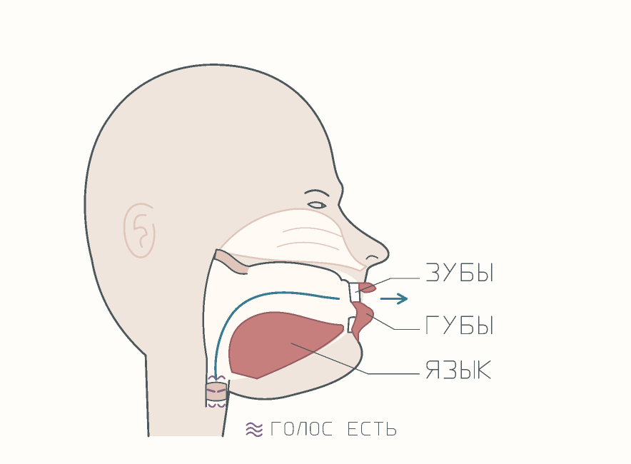
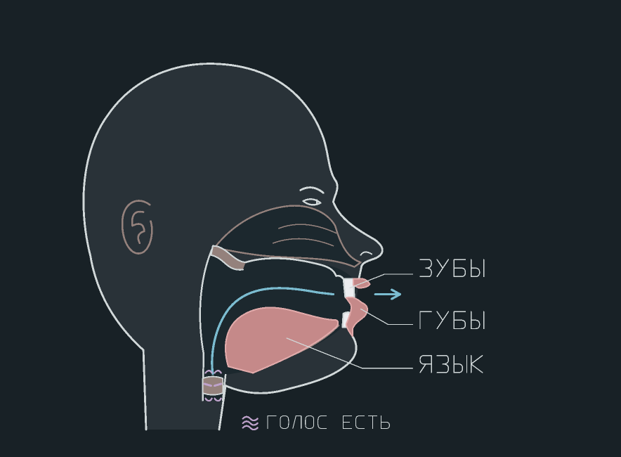
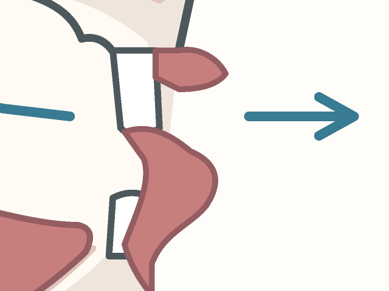

# Перерисовка схем TH, W и V — 28 октября 2026

Пользователь отклонил первый рисунок: профиль не узнавался как голова. Новый набор предназначен для визуального согласования Stage 1. Stage 2 не начат.

## Что изменено

Перерисован общий профиль: глаз, бровь, переносица, нос, губы, подбородок и шея. Голова смотрит вправо. Все боковые схемы используют буквально одинаковую группу `fixed-anatomy`. Меняются язык, нижние зубы для почти сомкнутого положения «с/з», губы, воздушная струя и значок голоса. Схемы W с ошибкой «в» и правильного V совпадают по положению органов речи. Ошибочного положения рта для V нет.

В отдельном крупном рисунке V есть подписи «ЗУБЫ», «ГУБЫ», «ЯЗЫК», «ГОЛОС ЕСТЬ» и увеличение рта. Стрелка V оставляет место контакта зубов и нижней губы открытым для просмотра. Гортань находится внутри контура шеи. Контур носовой полости усилен в тёмном варианте.





## Состояние работы и границы проверки

Baseline: `d88ff746480bb3692246db7df11469879a1180eb`, main; рабочая ветка `codex/articulation-2026-10-28`. На момент чтения открытых PR не было. CI baseline был cancelled, Quality Evolution — success; это не результаты проверки данной правки.

Локальная среда возвращает `No usable execution environment is available`. Поэтому этот коммит сохраняет перерисованные оригинальные SVG, воспроизводимый генератор и превью через GitHub. Он пока не содержит интеграцию компонента из недоступной локальной рабочей копии. Старый локальный коммит компонента: `4619210`; незакоммиченные изменения той копии нельзя считать восстановленными.

PNG получены собственным детерминированным растеризатором тех же векторных путей в JavaScript. Автор просмотрел каждый рисунок. Это **не Playwright и не скриншоты страниц курса**. Прежние скриншоты и результаты тестов не подтверждают эту новую редакцию.

Воспроизведение после восстановления среды:
```sh
node scripts/build_articulation_redraw.mjs
node scripts/build_articulation_redraw.mjs --check
node scripts/build_articulation_redraw.mjs --preview
```
Генератор выполнялся по своим функциям в доступном JavaScript runtime. Полный код генератора дополнительно исполнен с файловыми заглушками: полученные 12 SVG побайтно совпали с сохранёнными SVG. Запуск команд целиком через Node и проверка файлов через `--check` пока BLOCKED. При восстановлении нужно согласовать этот генератор с прежним `scripts/build_articulation.py`, чтобы старый генератор не вернул отклонённые рисунки.

## Самопроверка изображений

- Общая основа — профиль вправо, лицо и шея различимы; носовая полость, зубы, твёрдое/мягкое нёбо, язык, гортань показаны: да.
- θ ✗ — язык за зубами, зубы почти сомкнуты, узкая воздушная струя у передней части нёба, голос выключен: да.
- θ ✓ — кончик языка виден между зубами, непрерывная стрелка над кончиком, голос выключен: да.
- ð ✗ — та же позиция «з» за зубами, голос включён: да.
- ð ✓ — кончик языка между зубами, непрерывная стрелка над ним, голос включён: да.
- W ✗ — верхние зубы касаются внутренней стороны нижней губы, губы не округлены, голос включён: да.
- W ✓ — губы выдвинуты и округлены, губы не касаются зубов, задняя часть языка поднята к мягкому нёбу, голос включён: да.
- V ✓ — верхние зубы у внутренней стороны нижней губы, расслабленный язык, голос включён: да.
- W спереди — округлые губы с открытым центром: да.
- V спереди — верхние зубы лежат на нижней губе: да.

Это качественная самопроверка учебных схем, а не доказательство медицинской точности. Независимый просмотр первого варианта новой основы подтвердил узнаваемость и обнаружил три проблемы: стрелка перекрывала контакт V, гортань выходила за шею, носовая полость была слишком тусклой в тёмной теме. Все три исправлены. Повторный независимый просмотр новых PNG (светлый, тёмный и крупный фрагмент V) подтвердил исправление всех трёх замечаний. Новых блокирующих замечаний по этим превью нет. Проверка браузера и мобильного размера этим не заменяется.

## Источники для проверки описаний, без копирования рисунков

- [Rachel's English: TH](https://rachelsenglish.com/practice-tip-th/) — расслабленный язык, кончик между зубами, воздушная струя, различие по голосу.
- [Rachel's English: W](https://rachelsenglish.com/pronounce-w-consonant/) — округление губ и поднятая задняя часть языка.
- [Rachel's English: F/V](https://rachelsenglish.com/english-pronounce-f-v-consonants/) — контакт верхних зубов с внутренней поверхностью нижней губы.

Все контуры созданы самостоятельно. В SVG нет изображений, ссылок, шрифтов или других внешних ресурсов.

## Quality gates этой редакции

| Проверка | Статус | Основание |
|---|---|---|
| Correctness | BLOCKED | Геометрия просмотрена; обязательная проверка SVG через Playwright недоступна |
| Regression | BLOCKED | Полный Django suite и UI-тесты повторно не запущены |
| Security | PASS | Статическая проверка: нет scripts, event handlers, href, image, use, foreignObject или внешних ресурсов; только пути, подписи и локальные стили |
| Data Integrity | N/A | База, лексикон и миграции не изменяются |
| UX | BLOCKED | Превью просмотрены; страницы 1440/390 в двух темах ещё не проверены |
| Integration | BLOCKED | Компонент и manifest остались в недоступной локальной рабочей копии |
| Evidence | PASS | SVG, генератор и PNG сохранены; ограничения явно обозначены |

Перед закрытием Stage 1: восстановить и интегрировать локальную работу, проверить manifest/лексикон и общий компонент, отрендерить каждый SVG через Playwright, просмотреть картинки, запустить полный suite, CSS/UI проверки и снять реальные страницы 1440/390 в светлой/тёмной теме. Согласование этой перерисовки не заменяет этот этап.

Черновик PR: [#140](https://github.com/konstantin532/English-Encyclopedia/pull/140). Не слит; Stage 1 ожидает интеграции, обязательных проверок и одобрения пользователя.
