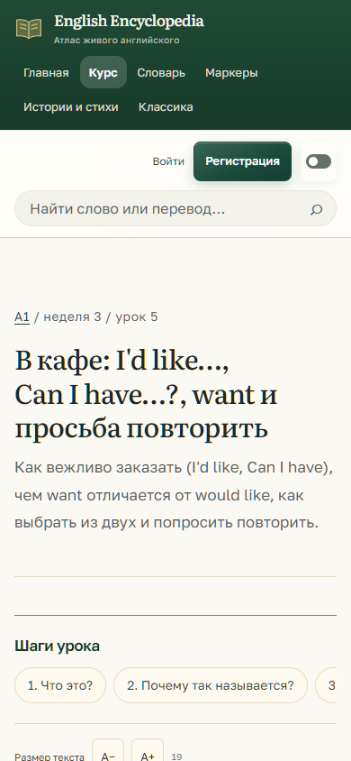
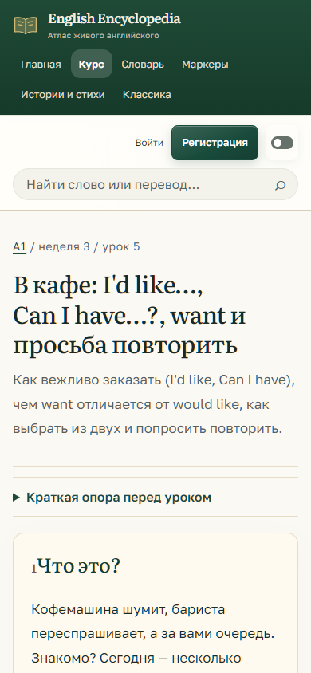

# Урок «Кафе»: первый экран на телефоне

База проверки: `e497032a928cc05401c46169704bd34599d179ad`, ветка `codex/editorial-pilot-20261029`, PR #141. Windows, CPython 3.13.16, установленный Chrome через Playwright, отдельная локальная SQLite. Проверка ограничена отображением пилота; учебные YAML, ответы, маркеры и изображения курса не менялись.

## Воспроизведение и исправление

На исходном коммите при 390×844 первый учебный абзац находился на 4674,14 px от верха документа. Унаследованное мобильное правило `order: -1` ставило словарь перед уроком; затем перед основным текстом раскрывалась вся вводная опора.

Для пилотного урока словарь следует после основного материала в том же порядке, что и HTML. Дополнительная опора стала нативным `details`: на телефоне она закрыта, на desktop с JavaScript раскрыта. Сам урок и все его слои всегда находятся снаружи `details`. Без JavaScript опора доступна с клавиатуры. Мобильные отступы заголовка уменьшены.

| 390×844, без прокрутки | До | После |
| --- | --- | --- |
| Первый учебный абзац | 4674,14 px | 748,50 px |
| Две строки первого абзаца | За пределами экрана | До 809,70 px при высоте 844 px |

| До | После |
| --- | --- |
|  |  |

При 360×844 первый абзац начинается на 779,09 px; две строки помещаются до 840,29 px. Это проверено до любой прокрутки, после загрузки шрифтов; тот же контракт проверяется при выключенном JavaScript на 390×844.

## Команды и результаты

- `uv run python manage.py migrate --noinput` и `uv run python manage.py load_content` — отдельная SQLite для браузера: 1047 единиц, 60 уроков, 30 недель с диалогом. Пользовательская база не использовалась.
- `uv run python manage.py test tests.test_editorial_pilot tests.test_a1_learning_route --parallel auto` — PASS, 11 тестов.
- `pnpm build:css` и `pnpm check:css` — PASS, 22 файла.
- `pnpm test:ui` — PASS, 172 теста.
- `node scripts/editorial_pilot_qa.cjs` — PASS, 16 сочетаний: 2 страницы × 4 ширины (1440, 1280, 390, 360) × 2 системные темы. Также PASS: режимы диалога, Enter/Space, no-JS, forced colors, увеличение текста, отсутствие ошибок JavaScript и горизонтального переполнения. Переменные запуска: `EE_PLAYWRIGHT_MODULE` указывает на установленный пакет, `EE_CHROMIUM_PATH` — на установленный Chrome, `EE_QA_URL` — `http://127.0.0.1:8017`, `EE_QA_OUTPUT` — локальная папка доказательств. [Полные измерения](editorial-pilot/cafe-mobile-first-screen-checks.json).
- Новая браузерная проверка сначала воспроизвела FAIL на исходном коде (4674,14 px); после исправления прошла.
- Первый `uv run python manage.py test tests --parallel auto` (4 процесса, local settings) — FAIL: 1161 тест, 1 падение, 8 skipped. `tests.test_a1_scaffold_variants.RotatingIndependentReviewTests.test_all_28_lessons_keep_minute_card_core_and_optional_independent_review` ожидал прежний тег вводного блока. Для пилота добавлена проверка закрытой опоры с единственным прежним разделом внутри; полный список соседних основных блоков и ожидания остальных уроков сохранены. Точечный повтор этого метода — PASS, 1 тест. Повтор полного набора со штатными `DJANGO_SETTINGS_MODULE=config.settings.test`, `DJANGO_TEST_PROCESSES=4` — **PASS: 1161 тест, 8 skipped, 279,945 с**.
- `git diff --check` — PASS.

## Границы и независимая проверка

Независимый агент прочитал весь diff исправления, исходную опору и снимок; существенных замечаний нет. Его замечание об ожидании шрифтов перед измерением исправлено. Отдельно проверена адаптация структурного теста: проверки основного материала и остальных уроков не ослаблены. Это техническое ревью ИИ, не приёмка преподавателем или учениками.

| Gate | Статус | Доказательство / граница |
| --- | --- | --- |
| Correctness | PASS | Исходный дефект воспроизведён, первый экран проверен в браузере с JS и без JS. |
| Regression | PASS | 11 затронутых Django-тестов, точечный повтор проверки 28 уроков, 172 UI-теста, браузерная матрица и полный набор 1161 (8 skipped) прошли. |
| Security | N/A | Изменения не затрагивают серверные права, обработку ответов и сессии; сохранено стандартное экранирование шаблона. Отдельный аудит безопасности не заявляется. |
| Data Integrity | PASS | YAML и модели не менялись; тесты сохранности исходных слоёв и упражнений прошли. |
| UX | PASS | Проверены начальный экран, клавиатура, no-JS, reduced motion, forced colors и размер текста. |
| Integration | BLOCKED | Итоговый CI на новом SHA ещё требуется проверить; локальная SQLite не заменяет PostgreSQL CI. |
| Evidence | PASS | Снимки без прокрутки, JSON координат, зафиксированный RED → GREEN и независимое ревью. |

Известное ограничение исходного пилота сохраняется: системная тёмная тема оставляет интерфейс светлым. Реальное устройство, production LCP, озвучка и эффективность обучения в эту проверку не входили. На высотах экрана, отличных от 844 px, первый экран отдельно не подтверждён.

Слияние и развёртывание не выполнялись. После зелёного CI — визуальная приёмка владельцем; этапы 1–3 этим исправлением не разрешаются.
