# Редакционный пилот — этап 0

Пилот ограничен A1 / неделей 3 и уроком `a1-cafe-order`. [PR №141](https://github.com/konstantin532/English-Encyclopedia/pull/141). Этапы 1–3, merge и deploy не выполнялись.

## Что сделано

Иллюстрация размещена над заголовком главы; диалог набран как пьеса с английской репликой, переводом и полными формами на полях. Урок получил типографическую иерархию, примечания и словарь с IPA. Сохранены учебные YAML, маркеры, упражнения, иллюстрации и навигация. Используются существующие шрифты и SCSS entry point; новых CSS-файлов и слоёв нет.

Примечания — нативные details/summary: открыты на широком экране, раскрываются на узком, читаются без JavaScript. Они находятся вне аудиореплики, поэтому раскрытие не запускает аудио.

## Что исправлено при завершении

1. Atlas искал обложку недели 3 только по старому классу. Проверка теперь понимает новый компонент и требует ровно одну загруженную обложку; проверки остальных недель сохранены.
2. Новая приёмка воспроизвела выход скороговорки за край на 3.984375 px при 1280×900. Сетка скороговорки теперь использует minmax(0, 1fr), а её элементы могут сжиматься. Для русской транскрипции восстановлен перенос строк: старое правило white-space:nowrap больше не расширяет колонку. Текст не скрывается и не обрезается.
3. Скомпилированный CSS синхронизирован с SCSS, включая Unicode в комментариях: посимвольная проверка сборки не допускает их замену на ASCII.
4. Приёмка пилота и пять парных LCP-замеров добавлены в GitHub Actions. При ошибке сохраняются страница, viewport, проблемные элементы и скриншот; процесс завершается с ошибкой.

## Проверки и доказательства

| Проверка | Результат |
|---|---|
| Django, полный локальный прогон | PASS — 1161 тест, 8 skipped, 357.847 s |
| UI | PASS — 172 теста |
| Компиляция CSS | PASS локально — 22 файла; два Unicode-комментария в опубликованном CSS синхронизированы с компилятором после замечания CI |
| Пилот, Chromium | PASS — 16/16 сочетаний: две страницы × 1440/1280/390/360 × light/dark preference |
| Поведение | PASS — режимы диалога, клавиатура, no-JS, forced colors, reduced motion, увеличение текста |
| Atlas вне пилота | PASS в том же браузерном запуске |
| Независимое ревью | Выполнено; блокирующих замечаний к исправлениям не осталось |

[Успешный браузерный запуск](https://github.com/konstantin532/English-Encyclopedia/actions/runs/40814712910) · [Артефакт со свежими скриншотами и сырыми измерениями](https://github.com/konstantin532/English-Encyclopedia/actions/runs/40814712910/artifacts/12872470424) · [Машиночитаемая сводка](editorial-pilot/ci-summary.json). GitHub хранит артефакт до 2026-11-12. Актуальные статусы общих CI jobs находятся в PR; старый сбой test был вызван несовпадением двух комментариев в CSS и произошёл до Python-тестов.

Команды:

~~~sh
python -X utf8 -B manage.py test tests --exclude-tag slow --parallel auto --settings=config.settings.test --noinput
python -X utf8 -B manage.py test tests --parallel auto --settings=config.settings.test --noinput
pnpm check:css
pnpm test:ui
node scripts/editorial_pilot_qa.cjs
node scripts/editorial_pilot_ci.cjs
~~~

CI runner использует ATLAS_PYTHON, ATLAS_BEFORE_DIR и Playwright через NODE_PATH. Артефакт atlas-browser-evidence содержит каталог editorial-pilot с матрицей, скриншотами и сырыми LCP-замерами. Это реальные страницы Django, а не макеты.

### История локальных сбоев

Первый полный прогон до обновления среды: 1161 тест, OK, 8 skipped. В одном быстром параллельном прогоне тест конкурентных запросов тренажёра получил 409 вместо 200; отдельные проверки прошли на baseline и пилоте. Причина этого эпизода не доказана, поэтому код тренажёра не менялся и исправление конкурентности не заявляется.

После обновления Windows массовые ошибки возникали при удалении tempfile в sandbox AC/Temp и при доступе Git к тестовым репозиториям. Подтверждение — PermissionError WinError 5 и git exit 128. Для повторных прогонов TEMP/TMP перенесены в рабочую папку, а safe.directory задан только в окружении процесса для checkout и его временных тестовых репозиториев. Глобальные настройки не изменялись; сами тесты не ослаблены. После исправления окружения полный прогон с --parallel auto завершился успешно: 1161 тест, 357.847 s, 8 skipped. Быстрый прогон до него повторил сбой MistakeReview (409 вместо 200/400); история сохранена, исправление этой конкурентности не заявляется.

## Метрики CSS

| Метрика | До | После |
|---|---:|---:|
| CSS-файлы | 28 | 28 |
| Строки всего CSS | 10 486 | 10 983 |
| Размер без сжатия, байт | 311 279 | 328 505 |
| Уникальные hex-цвета | 288 | 288 |
| Уникальные значения border-radius | 37 | 37 |
| Строки восьми слоёв оформления | 6 708 | 7 205 |

Метод: физические строки с LF, включая комментарии; цвета без учёта регистра и нормализованные значения border-radius после удаления комментариев. Переменные и составные значения считаются отдельными значениями. Восемь слоёв: app, studio, cinematic-studio, motion-system, art-direction, art-light, editorial-world, living-atlas. Пилот добавляет 497 строк; консолидация CSS относится к этапу 1. [Метрики](editorial-pilot/css-metrics.json), воспроизведение: node scripts/editorial_pilot_metrics.cjs.

## Производительность

Пять парных запусков в Chromium на CI, свежие контексты, 1440×900, reduced motion, без throttling:

| Страница | Медиана до | Медиана после |
|---|---:|---:|
| Неделя 3 | 460 мс | 400 мс |
| Урок кафе | 424 мс | 424 мс |

В этой выборке ухудшения LCP не обнаружено. Это измерения локальных Django-серверов на GitHub runner, не production LCP и не гарантия для мобильной сети. Сырые пять пар и скриншоты находятся в артефакте указанного запуска. Старые JSON browser-checks/performance-comparison и изображения ниже относятся к первоначальному локальному checkpoint; свежий результат зафиксирован в ci-summary.json.

## Границы проверки

- **PASS:** сохранность учебного содержимого и области пилота, автоматические проверки интерфейса в указанной матрице. Контраст выбранных текстов на бумажном фоне — минимум 5.63:1; это не полный аудит WCAG.
- **Известный FAIL baseline:** системная dark-схема оставляет data-theme=light. Матрица проверяет оба предпочтения, но не выдаёт светлый результат за настоящую тёмную тему. Консолидация тем относится к этапу 3.
- **BLOCKED:** прослушивание реальных записей и production LCP — нужны аудиофайлы/развёрнутая среда. Переключатели диалога и скрытие текста проверены браузером.
- Новых моделей, миграций, данных учеников или правил доступа нет. Локально использовались отдельный checkout и синтетическая база.

Baseline исходного пилота: d88ff746480bb3692246db7df11469879a1180eb. Все 14 исходных обложек загружались после запроса lazy-изображений. На неделе 3 уже была рисованная иллюстрация, поэтому её не заменяли. CI сравнивает с актуальной базой PR, её SHA указан в запуске.

## До и после

### Открытие главы, 1440 px

| До | После |
|---|---|
| 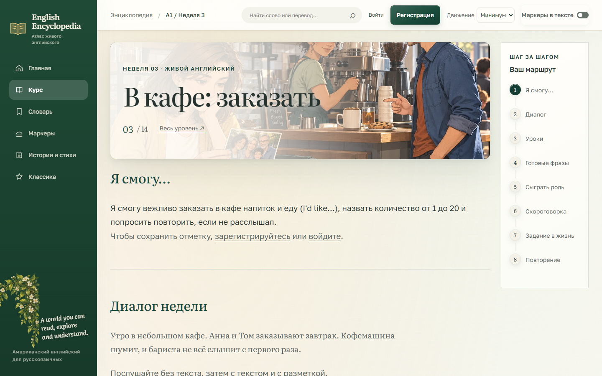 | 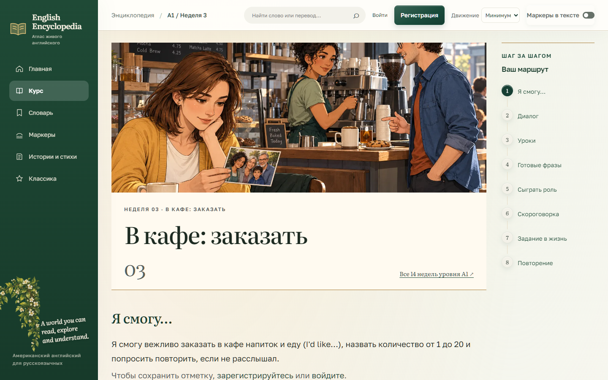 |

### Диалог, 1440 px

| До | После |
|---|---|
| 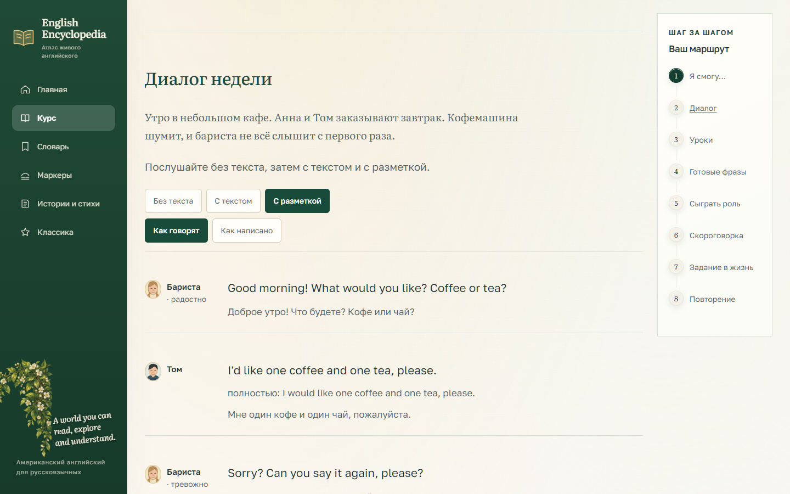 | 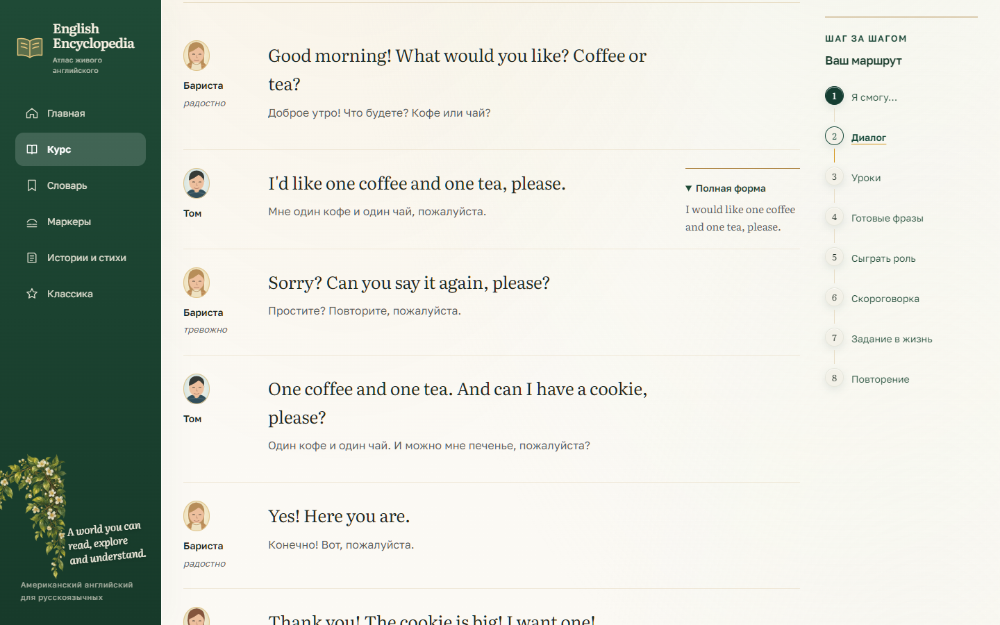 |

### Учебная полоса и словарь, 1440 px

| До | После |
|---|---|
| 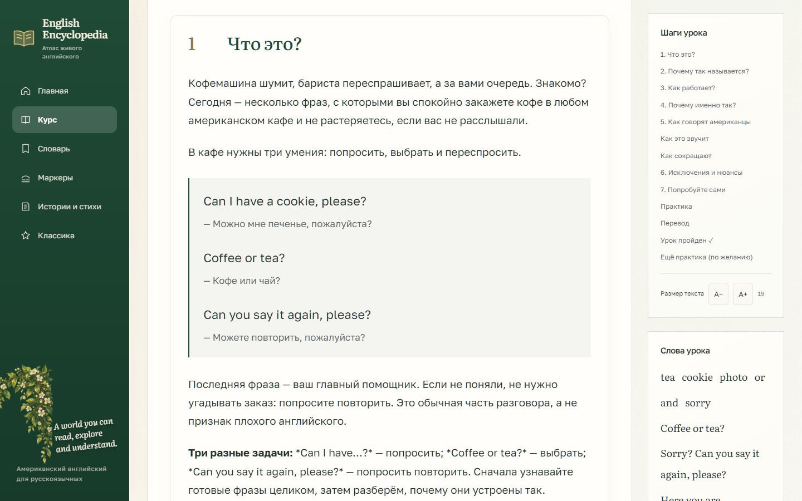 | 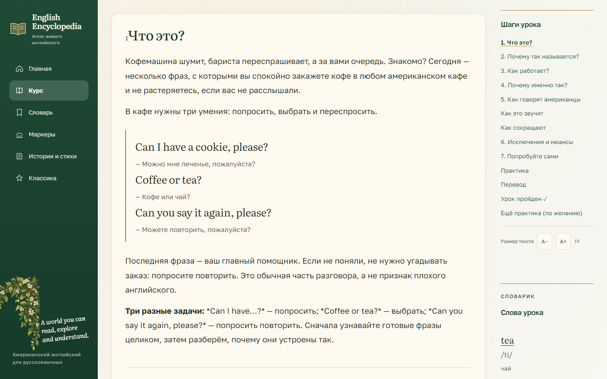 |

### Мобильный экран, 390 px

| До | После |
|---|---|
| 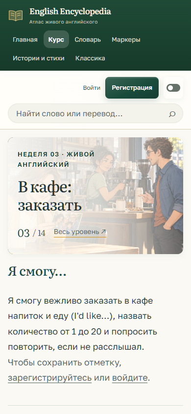 | 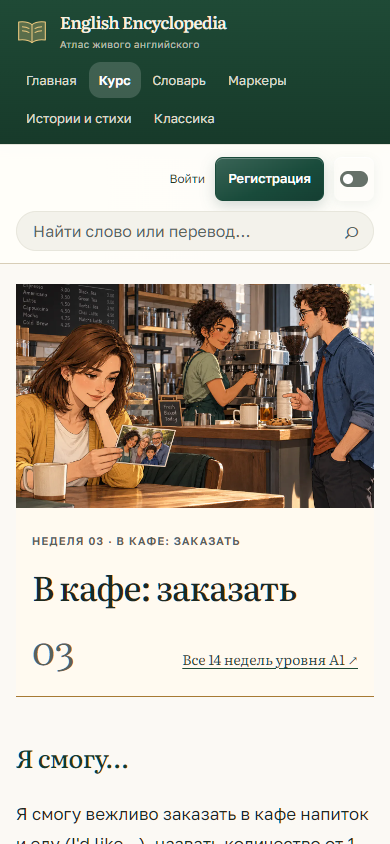 |
| 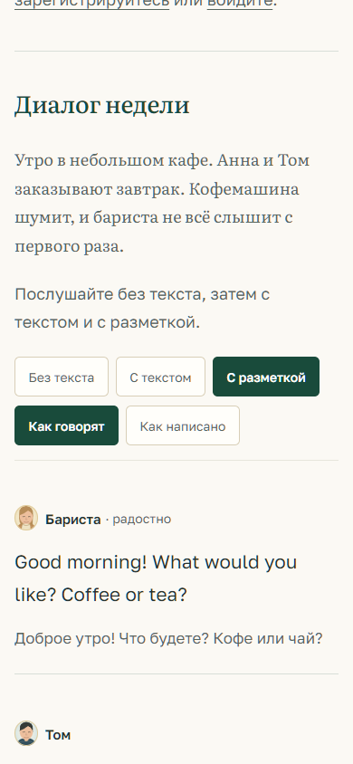 | 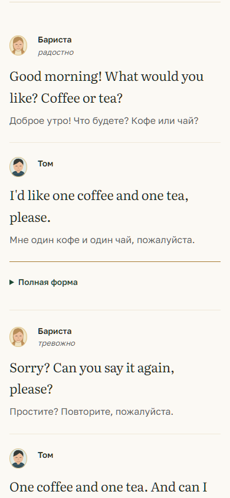 |
| 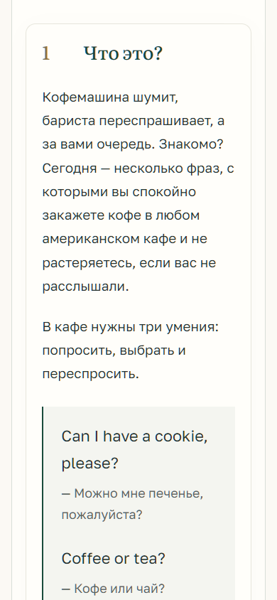 | 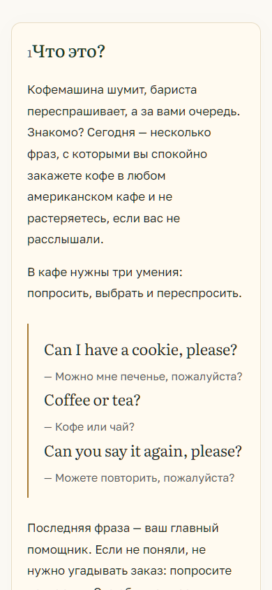 |

## Что дальше / что нужно от владельца

Оценить оформление двух пилотных страниц. Дальнейшее распространение и этапы 1–3 требуют отдельного решения владельца согласно исходному заданию. Слияние не выполнено.
