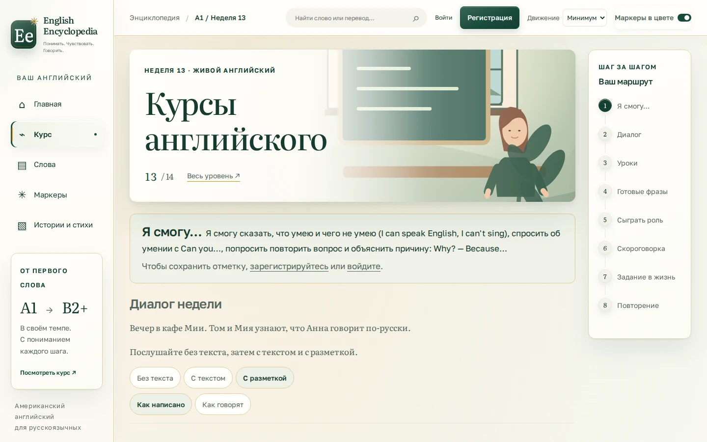
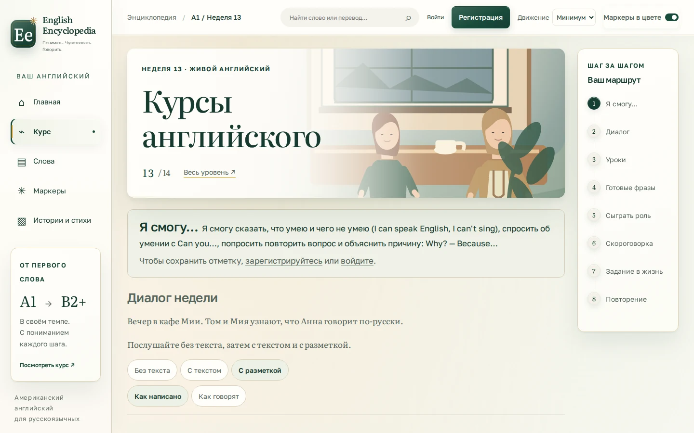
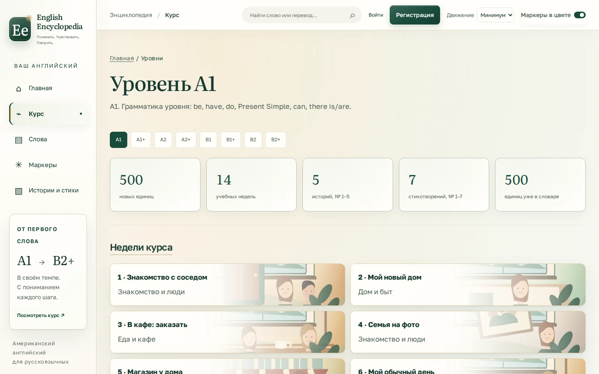
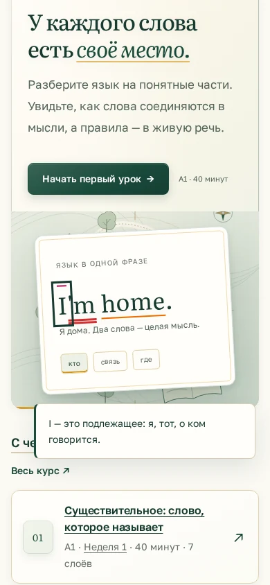
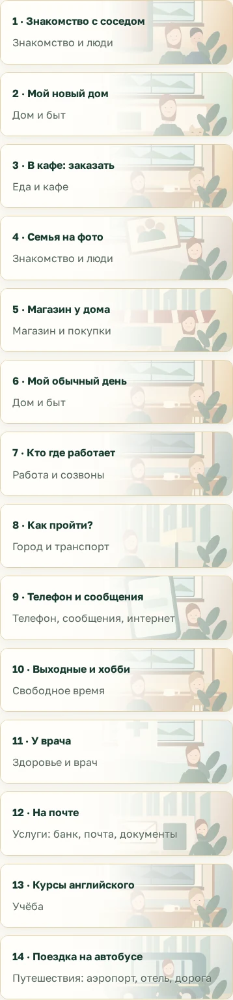

# Living Language Atlas — real browser review

## Scope and baseline
Baseline: main `7d27a5aee85b3431d380b03b215d758bc86bb4f4`, including merged PRs #45, #46 and #47. There were no open PRs at initial inspection. The inherited implementation already provided 14 vector covers and portrait badges; this revision does not claim those as newly created work.

The original homepage reused the cafe image behind the phrase. Weeks 6/7/10/13 illustrated the topic (home, work, park, classroom) rather than their actual recurring cafe setting. The previous discovery replaced a short translation with a longer explanation inside the paper card.

Implemented: original cartographic frontispiece; more accurate recurring cafe covers; evening palette where evening is confirmed; descriptive alt text on 14 chapter heroes; word/caption discovery without changing card contents; native keyboard support; motion-aware GSAP fade; source Sass and generated CSS; reproducible browser acceptance workflow. The week 3 photo is preserved. No model migrations, trainer algorithms, curriculum order, marker colors or user-data storage change.

## Automated verification
| Gate | Result |
|---|---|
| `pnpm build:css` | 17 stylesheets generated |
| `pnpm check:css` | 17 stylesheets match Sass |
| `pnpm test:ui` | 122 passed |
| Full Django suite, `--parallel 4` | 601 passed, 92.955 s |
| Django checks / collectstatic | Passed |
| `audit_course` | No errors; inherited CEFR warnings remain |
| Chromium before/after comparison | 12 screen/viewport pairs passed |
| Maximum selected-component geometry delta | 0 px in every pair |
| All 14 chapter images at 390 px | Loaded successfully |
| Horizontal overflow / uncaught JavaScript errors | None on tested pages |
| No-JS homepage / full-motion discovery | Passed |

The first full Django run had one audio-recovery failure; that test passed alone and the complete repeat passed. This is disclosed rather than silently discarding the failed run.

Browser evidence: [successful run 39329659244](https://github.com/konstantin532/English-Encyclopedia/actions/runs/39329659244), [original PNG screenshots and raw measurements](https://github.com/konstantin532/English-Encyclopedia/actions/runs/39329659244/artifacts/12223852805). Artifact retention is 14 days; selected WebP copies are checked into this directory for durable review. WebP files are compressed real screenshots with no compositional edits.

| Screen | 1440×900 | 1280×800 | 390×844 | 360×800 |
|---|---|---|---|---|
| Home | 0 px | 0 px | 0 px | 0 px |
| A1 collection | 0 px | 0 px | 0 px | 0 px |
| Week 13 chapter | 0 px | 0 px | 0 px | 0 px |

Measured selectors: sidebar, header, homepage hero, phrase paper, lesson cards, week cards, chapter hero, chapter route and story script wherever present. This is evidence for these components and states, not a claim of exhaustive visual regression coverage. Geometry while opening discovery uses document coordinates, so native mobile focus scrolling is not mistaken for layout shift.

## Actual screenshots
| Home — before | Home — after |
|---|---|
|  |  |

| Chapter — before | Chapter — after |
|---|---|
|  |  |

| Mobile discovery, 390 px | Chapter, 360 px |
|---|---|
|  |  |

## Art direction audit
- **Recognizability:** the frontispiece makes the atlas idea visible through a route, architectural vignettes, botanical linework and the retained language specimen. It replaces the repeated cafe backdrop on home without changing the learning layout.
- **Narrative correctness:** all 14 openings, outcomes and speaker sets were read from their weekly YAML. Four incorrect settings were corrected. Motif objects are distinguished from confirmed plot events in the art bible.
- **Illustrations and characters:** existing vector faces are reused. The inherited photo and vector character treatments are visibly different; canonical identity reconciliation is still required. These are stylized vector illustrations, not newly painted cinematic character scenes.
- **Cropping and hierarchy:** selected desktop/mobile screenshots retain readable chapter titles and the same heading wraps. Mobile illustrations remain secondary to the title; they are not required to understand the lesson. The map surrounds the phrase rather than competing with its learning markers.
- **Materials and color:** paper/sage/green remain; muted brass only affects editorial material tokens. Marker palette and classifications are untouched. The result retains some inherited extensive shadow treatments; a full cascade/material consolidation remains outside this checkpoint.
- **Interaction:** the real browser found and verified a fix for mobile focus scrolling. Focus remains on the word after Escape. Explanations work without GSAP; the static phrase and captions remain with JavaScript disabled.
- **Noise:** no continuous new animation, parallax, audio timer simulation or new competing motion controller. Full-mode local fade is brief and does not move the sentence.

## Limits and remaining work
This is a tested artistic/interaction checkpoint, not a claim that the entire master brief has been completed. Primary changes affect home, the A1 collection and chapter covers; lesson, dictionary, trainer, speech and progress screens retain the inherited editorial styling. A reusable diagram system for negation, questions and tense is not implemented. Full-scale visual rollout and full cascade consolidation remain.

No real Android device or screen-reader session was available. Browser screenshots and DOM tests do not prove TalkBack behavior or exhaustive contrast compliance. Real audio playback was not tested because audio files are absent from the checkout; existing player synchronization code is unchanged. No performance or Core Web Vitals improvement is claimed. Account/progress persistence is covered by existing Django tests, not a new end-to-end signed-in browser session.
