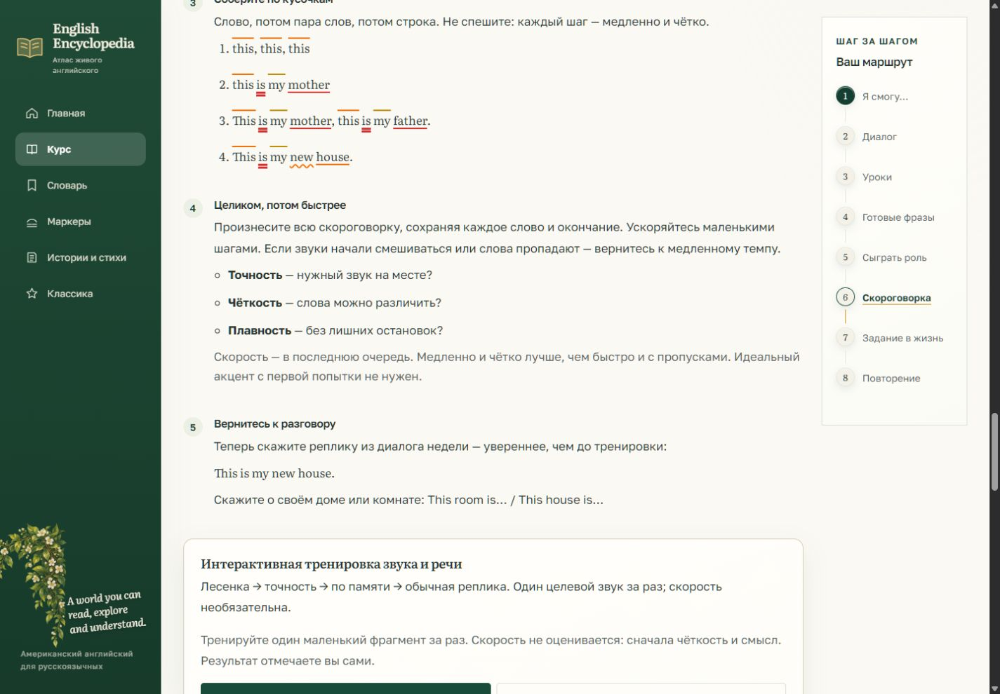
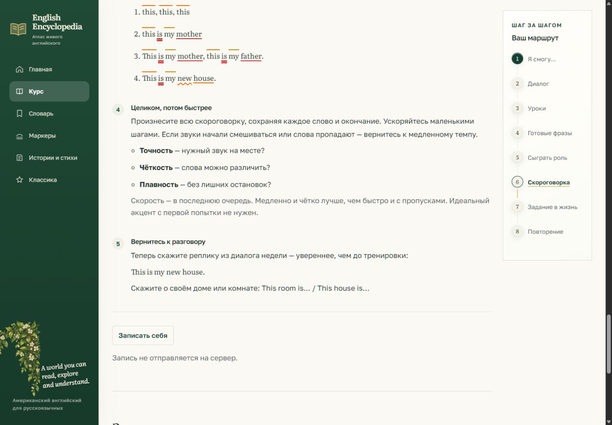
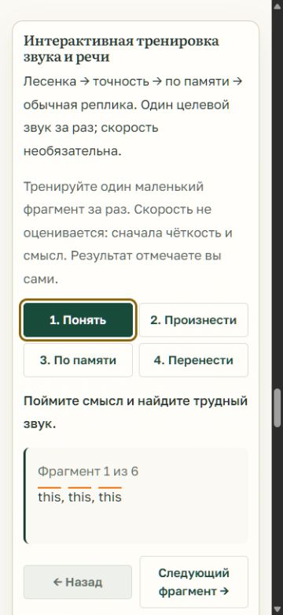
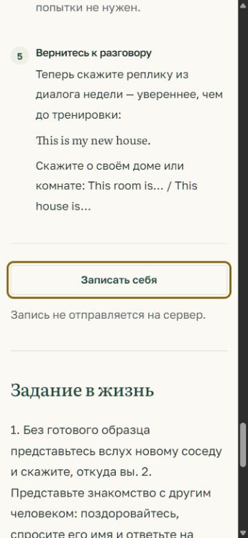

# Неделя и урок: убрать повторы и лишние пояснения

База: 55ecdea6. Ветка: codex/week-lesson-cleanup-20261028. Работа выполнена в отдельной копии проекта; main, исходная база и исходная папка F: не менялись. Preview: http://127.0.0.1:8003/levels/a1/weeks/1/ .

## Изменения

- На неделе скороговорка сохраняет пять шагов и три скорости. Общая мастерская, умное повторение, ритм и дополнительный shadowing-блок на неделе не рендерятся. Их данные и логика сохранены.
- На неделе остаётся одна компактная кнопка записи и одна фраза «Запись не отправляется на сервер.». После старта доступны остановка, прослушивание и удаление записи.
- Речевая мастерская остаётся в закрытом разделе «Ещё практика» урока. Убраны указанные дисклеймеры, включая текст, который раньше повторно добавлял JS.
- У главного аудиоплеера недели одна сноска «Голоса созданы нейросетью.». Ошибки отсутствия аудио и недоступности микрофона продолжают отображаться по существу.
- Recorder отделён от четырёх режимов мастерской. Микрофон запрашивается только при нажатии. Запись не отправляется и не сохраняется на сервер. Исправлены поздние разрешения и события старой записи, возврат через историю браузера; потоки и blobURL освобождаются.
- Только для preview скопированы 7 отсутствовавших локальных аудиофайлов недели 1 из исходной папки. Они не входят в Git. Новая озвучка не генерировалась.

## Проверки

- PASS: 21 лёгкий Python-тест без БД и браузера, 1.617 с: tests.test_week_lesson_copy, tests.test_lesson_core_template, tests.test_a1_learner_text. Новые проверки рендерят 14 недель A1 и 28 уроков A1, проверяют отсутствие лишнего текста и дублирующей студии, пять шагов/три скорости, единственность сносок и компактной записи, доступность при отсутствии аудио, сохранение мастерской внутри дополнительного раздела урока.
- PASS: 14 лёгких Node-тестов с подставным DOM, без настоящего браузера: tests/js/speech-studio.test.cjs, tests/js/speech-studio-browser.test.cjs. В том числе отдельный recorder без entries, очистка tracks/URL, позднее разрешение, двойное нажатие, возврат на сохранённую страницу и запоздалый stop после ошибки предыдущей записи.
- PASS: ручная браузерная проверка страницы недели 1 и урока a1-nouns-first-words на 1440×1000 и 375×812. Горизонтального переполнения нет. Три скорости выбирают нужные исходные записи; для медленной записи readyState=4; ошибок медиа не наблюдалось. На неделе студий 0, recorder 1. В уроке мастерская 1, дополнительный раздел изначально закрыт, статус «Отмечено 0 из 6.». Кнопка записи доступна с клавиатуры. Console warn/error пусты. Overrides размера сброшены.
- PASS: git diff --check. Изменений в content/, моделях и миграциях нет. База для этой задачи не изменялась.
- Интеграционный DB-тест tests.test_speech_studio обновлён под компактный недельный recorder, но не запускался: пользователь просил только быстрые проверки. Полный набор тестов и удалённый CI не запускались. Физический микрофон через браузер не включался; сценарии записи проверены на подставном MediaRecorder.

Команды:

```powershell
& F:/english-Encyclopedia/.venv/Scripts/python.exe manage.py test tests.test_week_lesson_copy tests.test_lesson_core_template tests.test_a1_learner_text --settings=config.settings.test --testrunner=django.test.runner.DiscoverRunner
& "C:/Program Files/nodejs/node.exe" --test tests/js/speech-studio.test.cjs tests/js/speech-studio-browser.test.cjs
```

## Скороговорка: требуется выбор пользователя до замены

В реестре family (LX-00001), mother (LX-00002), father (LX-00003) уже находятся в content/seed_lexicon/a1_w01_nouns.yaml. Семейная история подробнее раскрывается в неделе 4. Поэтому это не формальное опережение словаря; для сцены знакомства можно выбрать другой текст. Исходная скороговорка, IPA, разминка и озвучка пока не изменялись.

1. This is my book. This is my phone. This is my house.
2. Is this my book? Is this my phone? Is this my house?
3. This is my book. Is this my book? Yes, this is my book.

Рекомендация: вариант 1 — простой повтор знакомого утверждения. Во всех вариантах /ð/ тренируется в слове this. Программно сверены все английские слова с lemma/forms файлов a1_w01_*.yaml: новых слов нет (12, 12, 13 слов). После выбора нужно согласованно заменить текст, IPA, русское значение, разминку и соответствующую озвучку; не оставлять прежнее аудио под новым текстом.

## Скриншоты

| Размер | До | После |
| --- | --- | --- |
| 1440×1000 |  |  |
| 375×812 |  |  |

До: отдельный процесс со снимком шаблонов и JS из 55ecdea6, тот же read-only просмотр preview-данных. После: текущая рабочая ветка. Перед снимками в обеих версиях были доступны одинаковые исходные аудиофайлы. Процесс сравнения на 8004 остановлен после проверки.

Финал урока: [desktop](week-cleanup-screenshots/lesson-after-desktop.jpg), [375px](week-cleanup-screenshots/lesson-after-mobile-375.jpg).

## Изменённые файлы

- `static/js/speech-studio.js`
- `templates/components/script_player.html`
- `templates/components/speech_studio_controls.html`
- `templates/components/twister_trainer.html`
- `templates/curriculum/week.html`
- `templates/lessons/detail.html`
- `tests/js/speech-studio-browser.test.cjs`
- `tests/js/speech-studio.test.cjs`
- `tests/test_speech_studio.py`
- `templates/components/speech_recorder.html`
- `tests/test_week_lesson_copy.py`

Доказательства: этот отчёт, week-lesson-cleanup-tests.txt и 6 JPG в docs/reviews/week-cleanup-screenshots/.

Correctness PASS; Regression PASS в указанном объёме; Security PASS для локальной записи и её очистки; Data Integrity PASS (данные не изменены); UX PASS в браузере на двух размерах; Integration PASS локально; Evidence PASS. Это не полный аудит проекта или измерение эффективности курса.

PR/push/merge не выполнялись. Скороговорка ожидает выбора пользователя.
